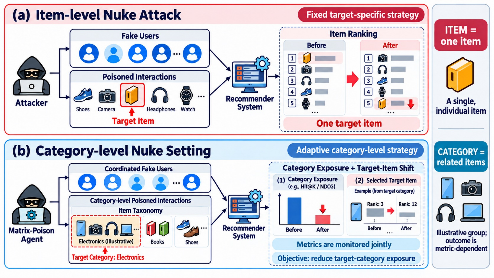

# Matrix-Poison Reproduction

基于论文 **Self-Evolving Matrix-Poison Agent on Recommender System** 的工程复现实现。  
该实现覆盖论文中的核心流程：

1. `Initialization`：场景统计 + 初始启发式攻击
2. `Analysis Phase`：对 `Random / Average / Bandwagon / Segmented` 做探测攻击并计算脆弱性排序
3. `Planning + Judging`：按排序生成混合策略，快速验证目标效果与隐蔽性
4. `Self-evolving`：根据反馈执行 `epsilon` 调节、`Mode Switching`、`Distribution Hybridization`

## 方法示意图

下图对比了传统的单物品级 Nuke 攻击与 Matrix-Poison 的类别级 Nuke 设置：



## 目录

- `matrix_poison/agent.py`：核心 Agent 闭环
- `matrix_poison/attacks.py`：四种基础攻击 + 混合器
- `matrix_poison/models.py`：`BPR / NeuMF / LightGCN / SASRec` 训练与打分
- `matrix_poison/metrics.py`：`Hit@K / NDCG@K / Prediction Shift / Stealth`
- `scripts/run_matrix_poison.py`：主实验脚本
- `scripts/preprocess_movielens1m.py`：MovieLens-1M 转换脚本
- `scripts/make_synthetic_dataset.py`：生成可快速验证的合成数据

## 数据格式

### interactions.csv

- `user_id`
- `item_id`
- `rating`
- `timestamp`（可选，建议保留）

### items.csv

- `item_id`
- `category`

## 快速开始

```bash
pip install -r requirements.txt
python scripts/make_synthetic_dataset.py --output-dir examples/synth
python scripts/run_matrix_poison.py \
  --interactions examples/synth/interactions.csv \
  --items examples/synth/items.csv \
  --target-category C1 \
  --intent nuke \
  --model bpr \
  --output-dir outputs/synth_run
```

## MovieLens-1M 示例

```bash
python scripts/preprocess_movielens1m.py \
  --ratings-dat /path/to/ml-1m/ratings.dat \
  --movies-dat /path/to/ml-1m/movies.dat \
  --output-dir data/ml1m

python scripts/run_matrix_poison.py \
  --interactions data/ml1m/interactions.csv \
  --items data/ml1m/items.csv \
  --target-category Action \
  --intent nuke \
  --model lightgcn \
  --max-iters 5 \
  --epsilon 0.005 \
  --clean-epochs 50 \
  --judge-epochs 12 \
  --output-dir outputs/ml1m_lightgcn_nuke
```

## 输出结果

- `run_summary.json`
  - clean 基线指标
  - 最优迭代、最优策略权重、最优 epsilon
  - 每轮迭代指标（objective / stealth / reward）
- `best_malicious_profiles.csv`
  - 最优毒化样本（可直接注入训练集）

## 说明

- 论文原文中的 LLM-分析器/规划器这里实现为可运行的“规则化语义梯度”闭环；  
  如果需要接入真实 LLM API，可在 `matrix_poison/agent.py` 的 `analysis_phase` 和 `self_evolve` 扩展提示优化逻辑。
- 默认遵循论文的灰盒设定：只基于可见交互数据训练本地 shadow/victim，不访问目标系统梯度与参数。

## CAMEL-AI 多 Agent 改写

当前实现已接入 CAMEL-AI 作为分析 / 规划 / 判断 / 自进化四阶段编排层：

- `matrix_poison/camel_orchestrator.py`：CAMEL 角色编排与 JSON 决策接口
- `matrix_poison/agent.py`：在每轮迭代调用 CAMEL 决策（带鲁棒 fallback）

默认行为：

- 若环境中有 `OPENAI_API_KEY`，将使用 `--camel-model` 指定模型（默认 `openai:gpt-4o-mini`）
- 若未设置 API Key，默认使用 CAMEL `STUB` 后端并自动回退规则策略，保证实验可跑通

可用参数（`scripts/run_matrix_poison.py`）：

- `--disable-camel`
- `--camel-model openai:gpt-4o-mini`
- `--camel-no-stub-fallback`
- `--disable-analysis-phase / --disable-planning-phase / --disable-judgment-phase / --disable-self-evolving`
- `--fixed-attack-method random|average|bandwagon|segmented`


## Train Baseline Target Models

Use the following command to pre-train baseline target-model parameters and save them under the project directory:

```bash
python scripts/train_target_baselines.py \
  --interactions data/ml1m/interactions.csv \
  --items data/ml1m/items.csv \
  --output-dir checkpoints/target_models/ml1m
```

This produces:

- `checkpoints/target_models/ml1m/bpr_baseline.pt`
- `checkpoints/target_models/ml1m/neumf_baseline.pt`
- `checkpoints/target_models/ml1m/lightgcn_baseline.pt`
- `checkpoints/target_models/ml1m/sasrec_baseline.pt`
- `checkpoints/target_models/ml1m/manifest.json`

## 按论文顺序一键实验

新增脚本 `scripts/run_paper_order_experiments.py`，按论文章节顺序执行：

1. `5.3.1` 单市场攻击有效性（RQ1）
2. `5.3.2` 与基线方法对比（RQ1 扩展）
3. `5.4` 跨市场攻击有效性（RQ2）
4. `5.5` 隐蔽性评估（RQ3）
5. `5.6` 消融实验（并生成 RQ4 脆弱性汇总）

示例（快速版）：

```bash
python scripts/run_paper_order_experiments.py --quick
```

输出包含：

- `paper_order_report.md`
- `paper_order_all_results.csv`
- `5_5_stealthiness.csv`
- `rq4_vulnerability_summary.csv`

## 已补充数据集（LastFM + Automotive）

当前项目已补充以下可直接运行的数据：

- `data/lastfm/interactions.csv`
- `data/lastfm/items.csv`
- `data/automotive/interactions.csv`
- `data/automotive/items.csv`

可复用构建脚本：

```bash
python scripts/build_matrix_poison_datasets.py
```

说明：

- LastFM 使用 `hetrec2011-lastfm-2k`，并基于 `user_taggedartists` + `tags` 构造 item 类别。
- Automotive 使用 Amazon Automotive 评分源（本地已保存为 `data/raw/automotive/raw.data`），类别统一为 `Automotive`。
